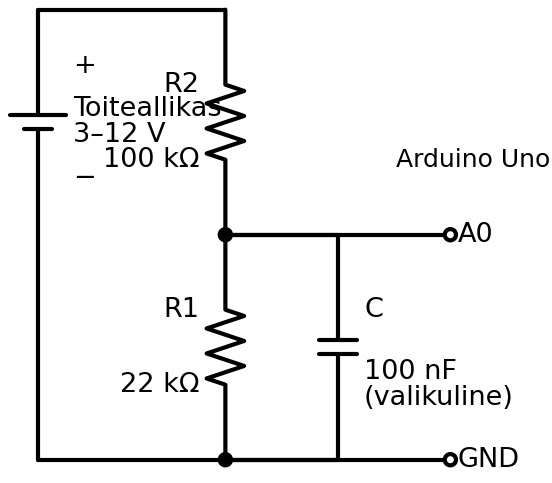
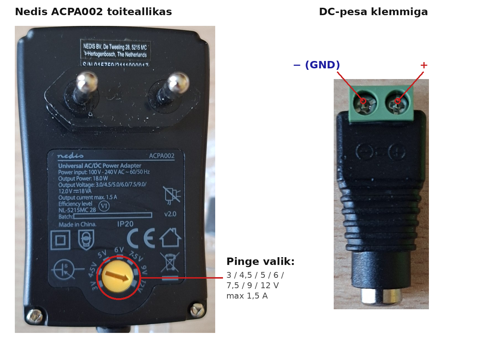
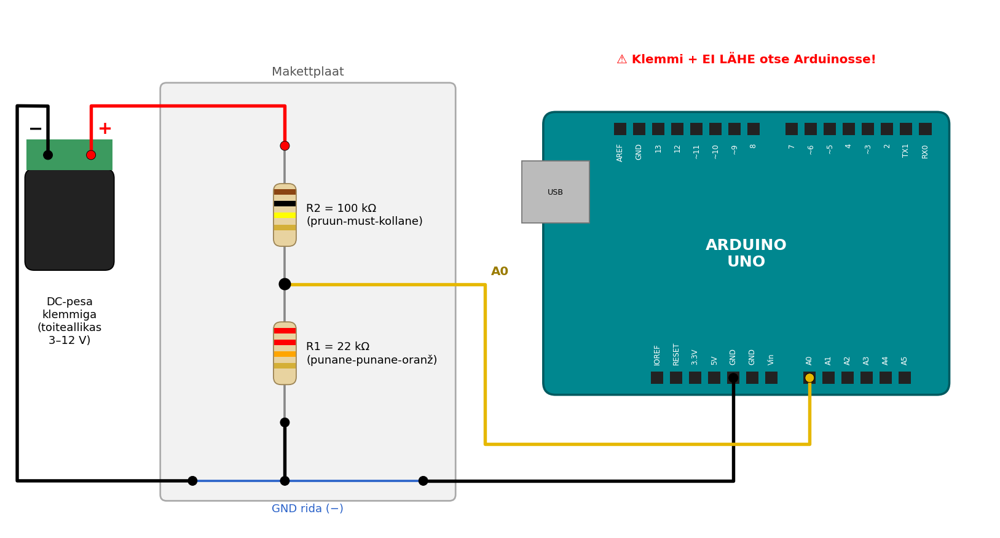
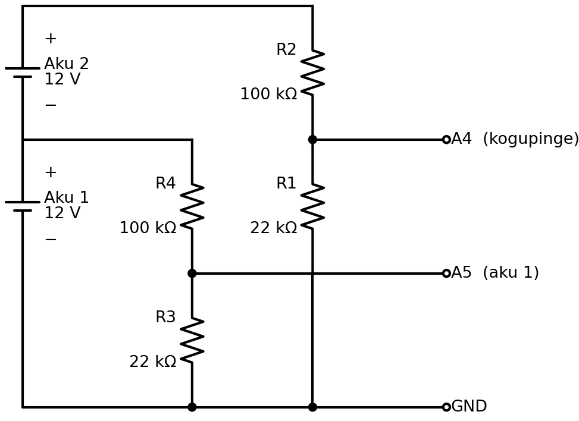

# Pinge mõõtmine Arduinoga (pingejagur)

## Sisukord
1. [Miks pinget mõõta?](#1-miks-pinget-mõõta)
2. [Pingeandurite tüübid](#2-pingeandurite-tüübid)
3. [Pingejagur](#3-pingejagur)
4. [Takistite valimine](#4-takistite-valimine)
5. [Ühendamine ja testimine toiteallikaga](#5-ühendamine-ja-testimine-toiteallikaga)
6. [Pinge lugemine](#6-pinge-lugemine)
7. [Kalibreerimine](#7-kalibreerimine)
8. [Kahe aku pinge mõõtmine](#8-kahe-aku-pinge-mõõtmine)

---

## 1. Miks pinget mõõta?

GreenPoweri autol on **kaks 12 V akut jadas**, kokku umbes **24 V**. Sõidu ajal akud tühjenevad ja pinge langeb. Pinget mõõtes saame teada:

- **Kui palju energiat on alles?** Pinge langus näitab, kui tühjad akud on.
- **Kas akud tühjenevad ühtlaselt?** Kui üks aku langeb teisest kiiremini, on see nõrgem.
- **Kui suur on võimsus?** Koos vooluanduriga ([04 tutorial](04%20Vooluandur%20Arduino%20tutorial.md)) saame arvutada:

$$P = U \times I$$

**Näide:** $U = 24\ V$ ja $I = 10\ A$ → $P = 240\ W$.

### Probleem

Arduino analoogpin (A0–A5) mõõdab pinget ainult vahemikus **0–5 V**. Kahe täis aku pinge on aga ~26 V.

> ⚠️ **Üle 5 V pinge otse analoogpinile rikub Arduino!**
> Ära kunagi ühenda akut ega toiteallikat otse A0–A5 pinile.

Seega peame suure pinge enne mõõtmist **väiksemaks tegema**, kindlas ja teadaolevas suhtes.

---

## 2. Pingeandurite tüübid

Nagu vooluandurite puhul, on ka pinge mõõtmiseks mitu võimalust.

#### 1. Pingejagur (2 takistit) ⭐ KASUTAME SEDA

**Põhimõte:** Kaks takistit jadas jagavad pinge kindlas suhtes (Oomi seadus).

**Plussid:**
- ✅ Väga odav (2 takistit, paar senti)
- ✅ Lihtne: ei vaja teeki ega lisakiipi
- ✅ Mõõtepiirkonda saab takistitega ise valida
- ✅ Arusaadav: kõik on arvutatav Oomi seadusega

**Miinused:**
- ❌ Pole galvaanilist eraldust (aku miinus = Arduino GND)
- ❌ Täpsus sõltub takistite tolerantsist ja Arduino 5 V täpsusest, seega vajab kalibreerimist
- ❌ **Vale ühenduse korral võib Arduino plaadi põletada!** Kui takistid on vahetuses või + juhe läheb kogemata otse analoogpinile, jõuab pinile üle 5 V.
- ❌ Arduino 10-bitine ADC annab ~27 mV sammu (vt [peatükk 4](#4-takistite-valimine))

#### 2. Valmis pingeandurimoodul („Voltage Sensor 0–25 V“)

**Põhimõte:** See on sama pingejagur (30 kΩ + 7,5 kΩ), aga valmis plaadil klemmidega.

**Plussid:**
- ✅ Mugav ühendada
- ✅ Odav (~1–2 €)

**Miinused:**
- ❌ Jagamistegur on 5, seega max **25 V**. Kahe täis laetud aku pinge (~25,6 V) on juba üle selle!
- ❌ Takistite väärtusi ei saa muuta

#### 3. INA219 / INA226 (I²C andurid)

**Põhimõte:** Kiip, millel on oma ADC. Mõõdab pinget **ja** voolu (šundi kaudu) ning saadab tulemuse I²C kaudu.

**Plussid:**
- ✅ Täpsem ADC (INA219: 12-bitine, INA226: 16-bitine)
- ✅ Mõõdab korraga pinget, voolu ja võimsust

**Miinused:**
- ❌ INA219 max **26 V** (kahe täis aku pinge on sellele liiga lähedal), INA226 max 36 V
- ❌ Vajab teeki ja I²C ühendust
- ❌ Moodulil olev šunt on tavaliselt ainult mõne ampri jaoks. Meie mootori voolu jaoks peaks šundi vahetama.
- ❌ Kallim (~3–10 €)

#### 4. Isoleeritud pingeandurid (nt LEM LV 25-P)

**Põhimõte:** Hall-efekt või isolatsioonivõimendi. Mõõdetav ahel ja Arduino on elektriliselt **eraldatud**.

**Plussid:**
- ✅ Galvaaniline eraldus (ohutu kõrgetel pingetel)
- ✅ Kõrged pinged (sadu volte)

**Miinused:**
- ❌ Kallis (kümneid eurosid)
- ❌ Vajab lisatoidet ja keerulisemat ühendust
- ❌ Meie 24 V süsteemis pole seda vaja

### Võrdlustabel

| Omadus | Pingejagur | Valmis moodul | INA219 | INA226 | Isoleeritud |
|--------|-----------|---------------|--------|--------|-------------|
| **Max pinge** | Vabalt valitav | 25 V | 26 V | 36 V | 500 V+ |
| **Sobib 2 akule (~26 V)?** | ✅ Jah | ❌ Ei | ⚠️ Napilt | ✅ Jah | ✅ Jah |
| **ADC** | Arduino 10-bit | Arduino 10-bit | 12-bit | 16-bit | Arduino 10-bit |
| **Ühendus** | Analoogpin | Analoogpin | I²C + teek | I²C + teek | Analoogpin + lisatoide |
| **Isolatsioon** | ❌ | ❌ | ❌ | ❌ | ✅ |
| **Hind** | ~0,05 € | ~1–2 € | ~3 € | ~5–10 € | ~30–60 € |

### Miks valime pingejaguri?

1. **Hind:** kaks takistit maksavad sente. Kui midagi läheb katki, on asendamine lihtne ja odav.
2. **Lihtsus:** ei vaja teeki ega I²C-d, ainult `analogRead()`.
3. **Paindlikkus:** mõõtepiirkonna valime ise, täpselt meie akude jaoks.
4. **Arusaadavus:** kogu mõõtmine on seletatav Oomi seadusega. Sama põhimõtet kasutasime juba termistori puhul ([03 tutorial](03%20Termistor%20Arduino%20tutorial.md)).
5. **Täpsus on piisav:** ~27 mV samm ja kalibreerimisega ~1% täpsus on aku jälgimiseks küllalt.

---

## 3. Pingejagur

### Skeem



- $U_{sisend}$ = mõõdetav pinge (aku või toiteallikas)
- $R_2$ = ülemine takisti (sisendi poolel), **100 kΩ**
- $R_1$ = alumine takisti (GND poolel), **22 kΩ**
- $U_{A0}$ = pinge takistite vahel, mida Arduino mõõdab

### Valem

Mõlemat takistit läbib **sama vool**:

$$I = \frac{U_{sisend}}{R_1 + R_2}$$

Pinge alumisel takistil $R_1$ (Oomi seadus $U = I \times R$):

$$U_{A0} = I \times R_1 = U_{sisend} \times \frac{R_1}{R_1 + R_2}$$

Arduinos teame $U_{A0}$ väärtust ja tahame leida $U_{sisend}$ väärtust. Pöörame valemi ümber:

$$U_{sisend} = U_{A0} \times \frac{R_1 + R_2}{R_1}$$

Murdu $\frac{R_1 + R_2}{R_1}$ nimetame **jagamisteguriks**.

### Näide

$R_1 = 22\ kΩ$, $R_2 = 100\ kΩ$:

$$\text{jagamistegur} = \frac{22\ kΩ + 100\ kΩ}{22\ kΩ} = \frac{122}{22} ≈ 5{,}55$$

| $U_{sisend}$ | $U_{A0} = U_{sisend} / 5{,}55$ | ADC väärtus |
|---|---|---|
| 3 V | 0,54 V | ~111 |
| 12 V | 2,16 V | ~443 |
| 24 V | 4,33 V | ~886 |
| 25,6 V | 4,62 V | ~945 |
| 27,7 V | 5,00 V | 1023 (maksimum!) |

Seega mõõdab see jagur pinget **kuni ~27,7 V**.

> 💡 **Mälusõna:** pinge jaguneb takistite vahel **nende suuruse järgi**. Suurema takisti peale jääb suurem osa pingest. $R_2$ on ~4,5 korda suurem kui $R_1$, seega jääb $R_2$ peale ~82% ja $R_1$ peale ~18% pingest.

---

## 4. Takistite valimine

### Samm 1: Maksimaalne pinge → jagamistegur

$$\text{jagamistegur} \geq \frac{U_{max}}{5\ V}$$

**Meie akud:**
- Üks 12 V pliiaku on täis laetuna ~12,8 V ja laadimise ajal kuni ~14,4 V.
- Kaks täis akut jadas: ~**25,6 V**. Sõidu ajal pinge ainult langeb.
- $\frac{25{,}6\ V}{5\ V} ≈ 5{,}1$ → meie komplekti takistitega (22 kΩ + 100 kΩ) saame **5,55**, seega jääb ~8% varu.

> ⚠️ **Miks varu on vaja?** Arduino „5 V“ ei ole alati täpselt 5,00 V. USB-toitel võib see olla 4,7–5,1 V. Kui Arduino toide on 4,8 V, siis ADC maksimum on ka 4,8 V ja mõõtepiirkond langeb ~26,6 V-ni.

> 💡 **Laadimise ajal** võib kahe aku pinge tõusta ~29 V-ni. See jääb meie jaguri piirkonnast välja: näit jääb 1023 peale kinni. Kui tahad mõõta ka laadimist, vali suurem $R_2$ (nt 120 kΩ → tegur ~6,5).

### Samm 2: Takistite suurus

Suhe $R_2 / R_1 ≈ 4{,}5$ võib olla nii 2,2 kΩ + 10 kΩ kui ka 2,2 MΩ + 10 MΩ. Kuidas valida?

| Kui takistid on … | Probleem |
|-------------------|----------|
| **Liiga väikesed** (nt 2,2 kΩ + 10 kΩ) | Jagurit läbib suur vool, mis tühjendab akut ja soojendab takisteid. 25,6 V / 12,2 kΩ ≈ 2,1 mA |
| **Liiga suured** (nt 2,2 MΩ + 10 MΩ) | Arduino ADC ei jõua korralikult mõõta, näidud on ebatäpsed ja hüplevad |
| **Paras** (22 kΩ + 100 kΩ) ✅ | Vool 25,6 V / 122 kΩ ≈ **0,21 mA**, akule tühine |

> 💡 Arduino ADC töötab kõige paremini, kui mõõdetava allika takistus on **alla ~10 kΩ**. Meie jaguril on see $R_1 \parallel R_2 = \frac{22 \times 100}{22 + 100} ≈ 18\ kΩ$, natuke üle piiri. Lahendus on **100 nF kondensaator** A0 ja GND vahel (skeemil valikuline). See hoiab pinget stabiilsena ja silub müra.

### Samm 3: Takistite täpsus (tolerants)

Takisti tegelik väärtus võib erineda märgitust:

| Tolerants | Takisti triip | Jagamisteguri viga (halvimal juhul) |
|-----------|---------------|-------------------------------------|
| ±5% | kuldne | ~±8% (nt 24 V asemel 22–26 V!) |
| ±1% | pruun | ~±1,7% |

Kasuta võimalusel **1% takisteid**. Ülejäänud vea parandame **kalibreerimisega** ([peatükk 7](#7-kalibreerimine)).

### Lahutusvõime

Arduino ADC on 10-bitine: 0–5 V jaotub 1024 sammuks.

$$\text{samm pinil} = \frac{5\ V}{1023} ≈ 4{,}9\ mV$$

$$\text{samm aku pingel} = 4{,}9\ mV \times 5{,}55 ≈ 27\ mV$$

Seega näeme aku pinge muutust umbes **0,03 V** kaupa. Aku jälgimiseks on see piisav.

---

## 5. Ühendamine ja testimine toiteallikaga

Laual testime **reguleeritava toiteallikaga**, mitte päris akuga: see on ohutum ja pinget saab muuta.



**Toiteallikas: Nedis ACPA002**
- Väljundpinge valitav: **3 / 4,5 / 5 / 6 / 7,5 / 9 / 12 V**
- Max vool: 1,5 A
- Pinge valitakse kollase ketta abil

**DC-pesa klemmiga:** toiteallika pistik läheb pessa, juhtmed kinnitatakse kruviklemmi. Klemmil on märgitud **− (GND)** ja **+**.

### Komponendid
- Arduino Uno
- Takistid: 100 kΩ ja 22 kΩ (võimalusel 1%)
- Kondensaator 100 nF (valikuline)
- Nedis toiteallikas + DC-pesa klemmiga
- Multimeeter
- Makettplaat (breadboard) ja juhtmed

### Ühendamine

1. **Toiteallikas vooluvõrgust VÄLJAS!**
2. Keera kollane ketas **3 V** peale.
3. Ühenda DC-pesa klemmiga toiteallika pistikuga.
4. Klemm **−** → makettplaadi GND rida → **Arduino GND**
5. Klemm **+** → **R2 (100 kΩ)**
6. R2 teine ots → **R1 (22 kΩ)** → GND rida
7. R1 ja R2 vaheline punkt → **Arduino A0**
8. (Valikuline) 100 nF kondensaator A0 ja GND vahele



**Kontrolli enne toite sisselülitamist:**
- ✅ Klemmi **+** ei ole otse ühendatud ühegi Arduino piniga, ainult R2 kaudu!
- ✅ Toiteallika − ja Arduino GND on ühendatud (**ühine GND**)
- ✅ R2 (100 kΩ) on **+** poolel, R1 (22 kΩ) GND poolel. Kui need on vahetuses, jõuab A0-le ~82% pingest ja 12 V juures on see juba ~10 V. **Arduino põleb!**

> ⚠️ **OHUTUS**
> - **Vali pinge enne**, kui toiteallika vooluvõrku ühendad. Ära keera ketast koormuse all.
> - **Kontrolli polaarsust multimeetriga** enne Arduinoga ühendamist: punane juhe klemmi +, must klemmi −. Näit peab olema **positiivne**.
> - Ära usalda ketta numbrit, **mõõda alati multimeetriga**. Tegelik pinge võib valitust erineda.

### Takistite värvikoodid

| Takisti | Värvid (4 triipu) | Värvid (5 triipu, 1%) |
|---------|-------------------|------------------------|
| 100 kΩ | pruun – must – kollane – kuldne | pruun – must – must – oranž – pruun |
| 22 kΩ | punane – punane – oranž – kuldne | punane – punane – must – punane – pruun |

---

## 6. Pinge lugemine

### Kood 1: ADC väärtus ja pinge pinil

```cpp
const int VOLT_PIN = A0;
const float VCC = 5.0;   // Arduino toitepinge

void setup() {
  Serial.begin(9600);
}

void loop() {
  int adc = analogRead(VOLT_PIN);
  float pinPinge = adc * (VCC / 1023.0);

  // Serial Plotter formaat
  Serial.print("ADC:");
  Serial.print(adc);
  Serial.print("\tPinPinge(V):");
  Serial.println(pinPinge, 3);

  delay(200);
}
```

**Mida peaksid nägema (toiteallikas 3 V peal):**
```
ADC:110   PinPinge(V):0.538
ADC:111   PinPinge(V):0.543
```

**Katseta:** lülita toiteallikas välja, keera ketas 6 V ja 12 V peale ja lülita uuesti sisse. Kas ADC väärtus kasvab 2 ja 4 korda?

### Kood 2: Sisendpinge arvutamine

```cpp
const int VOLT_PIN = A0;
const float VCC = 5.0;

// Pingejagur
const float R1 = 22000.0;    // Alumine takisti (GND poolel)
const float R2 = 100000.0;   // Ülemine takisti (+ poolel)
const float JAGAMISTEGUR = (R1 + R2) / R1;   // = 5.545

void setup() {
  Serial.begin(9600);
}

void loop() {
  int adc = analogRead(VOLT_PIN);
  float pinPinge = adc * (VCC / 1023.0);
  float sisendPinge = pinPinge * JAGAMISTEGUR;

  Serial.print("Pinge(V):");
  Serial.println(sisendPinge, 2);

  delay(200);
}
```

**Valem koodis:**

$$U_{sisend} = \underbrace{ADC \times \frac{5\ V}{1023}}_{U_{A0}} \times \underbrace{\frac{R_1 + R_2}{R_1}}_{5{,}545}$$

**Näide:** ADC = 443 → $U_{A0} = 443 \times \frac{5}{1023} = 2{,}165\ V$ → $U_{sisend} = 2{,}165 \times 5{,}545 = 12{,}0\ V$ ✅

### Test: võrdlus multimeetriga

Mõõda iga toiteallika pinge juures **multimeetriga** klemmi pinget ja kirjuta üles Arduino näit:

| Ketas | Multimeeter (V) | Arduino (V) | Vahe (V) | Viga (%) |
|-------|-----------------|-------------|----------|----------|
| 3 V | | | | |
| 4,5 V | | | | |
| 6 V | | | | |
| 7,5 V | | | | |
| 9 V | | | | |
| 12 V | | | | |

$$\text{Viga}(\%) = \frac{U_{Arduino} - U_{multimeeter}}{U_{multimeeter}} \times 100\%$$

**Küsimused:**
- Kas viga on kõigil pingetel **umbes sama protsent**? Mida see tähendab?
- Mõõda multimeetriga ka Arduino **5V** pini pinget. Kas see on täpselt 5,00 V?

---

## 7. Kalibreerimine

### Miks näit erineb?

1. **Arduino 5 V ei ole täpselt 5,00 V.** See on ADC võrdluspinge, nii et iga viga siin mõjutab kõiki mõõtmisi.
2. **Takistite tolerants:** 22 kΩ võib olla tegelikult 21,8 kΩ.
3. **ADC enda viga:** paar sammu.

Kui viga on kõigil pingetel **sama protsent**, piisab ühest **kalibreerimistegurist** (korrutisest). Kui viga muutub pingega, kasuta **lineaarset kalibreerimist** ([01 tutorial](01%20Kalibreerimine.md)).

### Meetod 1: Täpne VCC väärtus

Mõõda multimeetriga Arduino **5V** ja **GND** pini vaheline pinge ning pane see koodi:

```cpp
const float VCC = 4.92;   // Multimeetriga mõõdetud!
```

See parandab ära kõige suurema veaallika.

> ⚠️ USB-toite pinge sõltub arvutist ja kaablist. Kui vahetad arvutit või toiteallikat, mõõda uuesti!

### Meetod 2: Kalibreerimistegur

$$k = \frac{U_{multimeeter}}{U_{Arduino}}$$

**Näide:**
- Multimeeter: 12,05 V
- Arduino: 11,82 V
- $k = \frac{12{,}05}{11{,}82} = 1{,}019$

Koodis: `sisendPinge = pinPinge * JAGAMISTEGUR * K_KALIBR;`

💡 Arvuta $k$ mitme pinge juures (tabelist) ja võta **keskmine**.

### Meetod 3: Lineaarne kalibreerimine

Kui tabelis on viga väikestel ja suurtel pingetel erinev, kasuta sirget:

$$U_{õige} = a \times U_{Arduino} + b$$

Kahe punkti põhjal (nt 3 V ja 12 V):

$$a = \frac{U_{mm,2} - U_{mm,1}}{U_{A,2} - U_{A,1}} \qquad b = U_{mm,1} - a \times U_{A,1}$$

Täpsemalt saab $a$ ja $b$ leida kõigi punktide põhjal Excelis: `=SLOPE(...)` ja `=INTERCEPT(...)`.

### Kood 3: Kalibreeritud ja silutud pinge

```cpp
const int VOLT_PIN = A0;
const float VCC = 5.0;           // Asenda multimeetriga mõõdetud väärtusega!

const float R1 = 22000.0;
const float R2 = 100000.0;
const float JAGAMISTEGUR = (R1 + R2) / R1;

const float K_KALIBR = 1.000;    // Kalibreerimistegur (meetod 2)

const int PROOVE = 10;           // Mitme mõõtmise keskmine

float loePinge() {
  long summa = 0;
  for (int i = 0; i < PROOVE; i++) {
    summa += analogRead(VOLT_PIN);
    delay(2);
  }
  float adc = summa / (float)PROOVE;
  float pinPinge = adc * (VCC / 1023.0);
  return pinPinge * JAGAMISTEGUR * K_KALIBR;
}

void setup() {
  Serial.begin(9600);
}

void loop() {
  float pinge = loePinge();

  Serial.print("Pinge(V):");
  Serial.println(pinge, 2);

  delay(200);
}
```

**Kalibreerimise sammud:**
1. Mõõda Arduino 5V pini pinge ja pane see `VCC` väärtuseks.
2. Täida tabel peatükist 6 uuesti.
3. Kui viga on endiselt >1%, arvuta `K_KALIBR` (meetod 2).
4. Kontrolli: täida tabel **kolmandat korda**. Viga peaks nüüd olema alla 1%.

---

## 8. Kahe aku pinge mõõtmine

### Kuidas see autos käib?

Autos on **kaks akut jadas**. Tahame teada **mõlema aku pinget eraldi**. Selleks kasutame **kahte pingejagurit**:



| Jagur | Mõõdab | Arduino pin |
|-------|--------|-------------|
| R1 + R2 | **Kogupinge** (aku 1 + aku 2), kuni ~27,7 V | A4 |
| R3 + R4 | **Aku 1** pinge, kuni ~14,5 V | A5 |

**Aku 2** pinget otse ei mõõda, vaid arvutame:

$$U_{aku2} = U_{kogu} - U_{aku1}$$

> 💡 Skeemil ristub A5 juhe R1 juhtmega **ilma punktita**. See tähendab, et juhtmed **ei ole** ühendatud, vaid lihtsalt ristuvad joonisel.

### Miks mitte mõõta aku 2 pinget otse?

Aku 2 miinus ei ole GND-ga ühendatud, see on ~12 V peal. Arduino mõõdab alati pinget **GND suhtes**, seega saame mõõta ainult pingeid, mis „algavad“ GND-st.

> ⚠️ **Vigade liitumine:** $U_{aku2}$ arvutatakse kahest mõõtmisest, seega liituvad mõlema vead. Kalibreeri **mõlemad jagurid** eraldi!

### Kood 4: Kaks akut

```cpp
const int PIN_KOGU = A4;   // Kogupinge jagur
const int PIN_AKU1 = A5;   // Aku 1 jagur
const float VCC = 5.0;

const float R1 = 22000.0;
const float R2 = 100000.0;
const float JAGAMISTEGUR = (R1 + R2) / R1;   // Mõlemal jaguril sama

// Kalibreerimistegurid (iga jagur eraldi!)
const float K_KOGU = 1.000;
const float K_AKU1 = 1.000;

const int PROOVE = 10;

float loePinge(int pin, float k) {
  long summa = 0;
  for (int i = 0; i < PROOVE; i++) {
    summa += analogRead(pin);
    delay(2);
  }
  float adc = summa / (float)PROOVE;
  return adc * (VCC / 1023.0) * JAGAMISTEGUR * k;
}

void setup() {
  Serial.begin(9600);
}

void loop() {
  float kogu = loePinge(PIN_KOGU, K_KOGU);
  float aku1 = loePinge(PIN_AKU1, K_AKU1);
  float aku2 = kogu - aku1;

  Serial.print("Kogu(V):");
  Serial.print(kogu, 2);
  Serial.print("\tAku1(V):");
  Serial.print(aku1, 2);
  Serial.print("\tAku2(V):");
  Serial.println(aku2, 2);

  delay(200);
}
```

### Testimine ühe toiteallikaga

Meil on laual ainult üks toiteallikas, aga koodi saab ikkagi testida:

1. Ühenda **mõlemad jagurid** (R2 ja R4 ülemised otsad) toiteallika **+** klemmi külge, alumised otsad GND-sse.
2. Nüüd mõõdavad mõlemad jagurid **sama pinget**.
3. Oodatav tulemus: `Kogu ≈ Aku1` ja `Aku2 ≈ 0 V`.
4. Kui `Aku2` ei ole ~0 V, on jagurite vahel erinevus. **Kalibreeri** `K_KOGU` ja `K_AKU1` nii, et mõlemad näitaksid multimeetriga sama pinget.

> 💡 Kui klassis on kaks toiteallikat, saab ühendada need **jadas** (esimese + → teise −) ja testida päris kahe „aku“ olukorda.

---

## Kokkuvõte

✅ Arduino analoogpin mõõdab ainult **0–5 V**. Suurem pinge otse pinile rikub Arduino!  
✅ **Pingejagur** (2 takistit) on odavaim ja lihtsaim viis suurt pinget mõõta  
✅ Valem: $U_{sisend} = U_{A0} \times \frac{R_1 + R_2}{R_1}$  
✅ 22 kΩ + 100 kΩ → jagamistegur **~5,55**, mõõtepiirkond kuni **~27,7 V**  
✅ Jäta varu: Arduino 5 V ei ole alati täpselt 5,00 V  
✅ Liiga väikesed takistid tühjendavad akut, liiga suured teevad näidu ebatäpseks  
✅ **Kalibreeri:** mõõda VCC multimeetriga, arvuta kalibreerimistegur  
✅ Kaks akut: mõõda **kogupinge** ja **aku 1**, aku 2 = vahe  
✅ Testi reguleeritava toiteallikaga ja võrdle multimeetriga  

## Teised allikad:
- [Voltage divider (SparkFun)](https://learn.sparkfun.com/tutorials/voltage-dividers/all)
- [Arduino analogRead()](https://docs.arduino.cc/language-reference/en/functions/analog-io/analogRead/)
- [Nedis ACPA002 kasutusjuhend](https://attachments.content4us.com/datasheets/ACPA002_MAN_COMP_0618_low.PDF)
