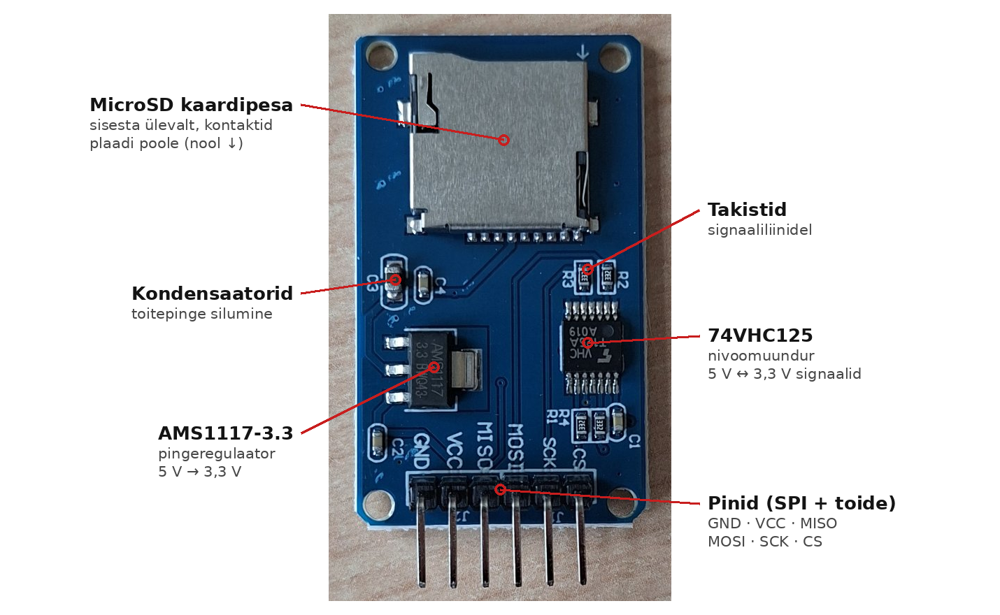
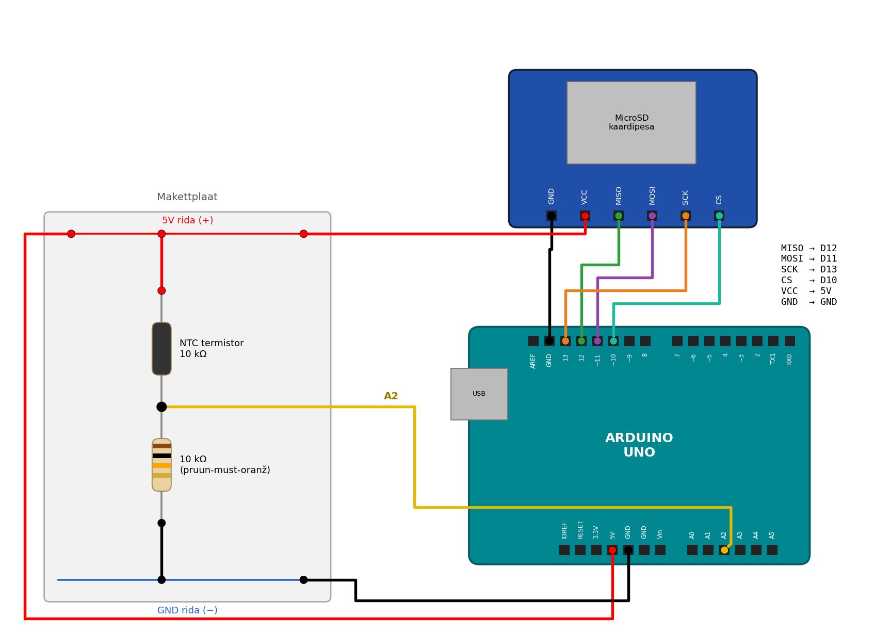

# Andmete salvestamine MicroSD-kaardile Arduinoga

## Sisukord
1. [Miks andmeid salvestada?](#1-miks-andmeid-salvestada)
2. [Mis on SPI?](#2-mis-on-spi)
3. [MicroSD mooduli ehitus](#3-microsd-mooduli-ehitus)
4. [Ühendamine ja kaardi ettevalmistus](#4-ühendamine-ja-kaardi-ettevalmistus)
5. [Esimesed katsed](#5-esimesed-katsed)
6. [Kuidas kirjutamine tegelikult käib?](#6-kuidas-kirjutamine-tegelikult-käib)
7. [CSV-logimine](#7-csv-logimine)
8. [Telemeetria logija: termistor + vooluandur](#8-telemeetria-logija-termistor--vooluandur)
9. [Andmed arvutisse](#9-andmed-arvutisse)
10. [Levinud vead](#10-levinud-vead)

---

## 1. Miks andmeid salvestada?

Seni oleme kõiki mõõtmisi vaadanud **Serial Monitoris** või **Serial Plotteris**. See töötab laual, kus Arduino on USB-kaabliga arvuti küljes. GreenPoweri autos aga **arvutit ei ole**: auto sõidab rajal, piloot keskendub sõitmisele ja keegi ei hoia sülearvutit kõrval.

**Lahendus:** Arduino kirjutab kõik mõõtmised **MicroSD-kaardile**. Pärast sõitu võtame kaardi välja, paneme arvutisse ja analüüsime andmeid rahulikult.

**Mida me pärast sõitu teada tahame?**
- Kui palju voolu mootor tõusul võttis?
- Kui kuumaks mootor ja aku läksid?
- Kuidas aku pinge sõidu jooksul langes?
- Kus rajal kulus kõige rohkem energiat?

**Andmeloger** (ingl *data logger*) on seade, mis salvestab mõõtmisi kindla ajavahemiku tagant koos ajatempliga. Just selle me selles tutorialis ehitame.

---

## 2. Mis on SPI?

### Definitsioon

**SPI** (*Serial Peripheral Interface*) on jadaliides, mille kaudu mikrokontroller suhtleb teiste kiipidega: SD-kaardi, ekraani, andurite ja muuga. Andmed liiguvad **bitt biti haaval** kindla **taktsignaali** järgi.

SPI-s on alati üks **ülem** (Arduino) ja üks või mitu **alluvat** (SD-kaart, ekraan jne). Suhtluse alustab ja lõpetab alati ülem.

### SPI neli liini

| Liin | Täisnimi | Suund | Ülesanne |
|------|----------|-------|----------|
| **SCK** | Serial Clock | Arduino → moodul | Taktsignaal: iga impulsi ajal liigub üks bitt |
| **MOSI** | Master Out, Slave In | Arduino → moodul | Andmed Arduinolt kaardile |
| **MISO** | Master In, Slave Out | moodul → Arduino | Andmed kaardilt Arduinole |
| **CS** | Chip Select | Arduino → moodul | „Sinuga räägin nüüd!“ (aktiivne LOW) |

> 💡 Uuemates materjalides nimetatakse neid liine ka **COPI** (Controller Out, Peripheral In) ja **CIPO** (Controller In, Peripheral Out). Tähendus on sama.

### Analoogia: klassiruum

Kujuta ette, et õpetaja (Arduino) räägib õpilastega (seadmed):
- **CS** – õpetaja ütleb nime: „Mari, nüüd sina!“ Ainult Mari kuulab ja vastab, teised on vait.
- **SCK** – õpetaja koputab lauale rütmi. Iga koputuse ajal öeldakse üks „täht“.
- **MOSI** – õpetaja räägib, Mari kuulab.
- **MISO** – Mari vastab, õpetaja kuulab.

Kuna igal seadmel on **oma CS-liin**, saab samadel SCK/MOSI/MISO liinidel olla mitu seadet.

### Miks just SPI?

| Omadus | SPI | I²C | UART (Serial) |
|--------|-----|-----|---------------|
| Juhtmeid | 4 (+ 1 CS iga lisaseadme kohta) | 2 | 2 |
| Kiirus | Väga kiire (MHz) | Keskmine (100–400 kHz) | Aeglane (nt 9600–115200 bit/s) |
| Mitu seadet | Jah, igaühel oma CS | Jah, aadressidega | Tavaliselt üks |
| Tüüpiline kasutus | SD-kaart, ekraanid | Andurid, RTC | Arvuti, GPS |

SD-kaardile kirjutatakse palju andmeid, seega on kiire SPI selleks sobivaim.

### Sõnastik

| Inglise keeles | Eesti keeles |
|----------------|--------------|
| master / controller | ülem |
| slave / peripheral | alluv |
| clock | takt, taktsignaal |
| chip select | kiibivalik |
| level shifter | nivoomuundur |
| voltage regulator | pingeregulaator |
| file system | failisüsteem |
| buffer | puhver |
| timestamp | ajatempel |
| data logger | andmeloger |

---

## 3. MicroSD mooduli ehitus



### Mooduli osad

| Osa | Ülesanne |
|-----|----------|
| **MicroSD kaardipesa** | Siia läheb kaart. Sisesta ülevalt, kontaktid plaadi poole. |
| **AMS1117-3.3 pingeregulaator** | Muudab 5 V toitepinge 3,3 V-ks, sest SD-kaart töötab **3,3 V** peal. |
| **74VHC125 nivoomuundur** | Muudab Arduino 5 V signaalid (SCK, MOSI, CS) kaardile sobivaks 3,3 V-ks. |
| **Kondensaatorid (C1–C4)** | Siluvad toitepinget. Kaart võtab kirjutamise ajal lühikesi voolupiike. |
| **Takistid (R1–R3)** | Signaaliliinidel, tagavad liinide kindla oleku. |
| **6 pini** | GND, VCC, MISO, MOSI, SCK, CS |

### Miks on vaja regulaatorit ja nivoomuundurit?

Arduino Uno töötab **5 V** loogikaga: kui pin on HIGH, on seal ~5 V. SD-kaart on aga **3,3 V** seade. Üle 3,6 V pinge võib kaardi **jäädavalt** rikkuda.

```
Arduino (5 V)  ──►  74VHC125  ──►  SD-kaart (3,3 V)
                   nivoomuundur
```

Selles moodulis on mõlemad probleemid juba lahendatud. Me võime Arduino otse mooduliga ühendada.

> ⚠️ **OLULINE: VCC → 5 V, mitte 3,3 V!**
> Moodulil on oma 3,3 V regulaator. AMS1117 vajab sisendisse umbes 1,1 V rohkem kui väljundisse, ehk vähemalt ~4,5 V. Kui ühendad VCC Arduino 3,3 V piniga, saab kaart liiga vähe pinget ja töötab ebastabiilselt või üldse mitte.

---

## 4. Ühendamine ja kaardi ettevalmistus

### Komponendid
- Arduino Uno
- MicroSD kaardimoodul (pildil olev)
- MicroSD-kaart (**kuni 32 GB**)
- Isa-ema juhtmed (6 tk)
- NTC termistor + 10 kΩ takisti ([03 tutorial](03%20Termistor%20Arduino%20tutorial.md))

### Ühendamine Arduino Unoga

Arduino Unol on SPI-liinid **kindlate pinide küljes**. Neid ei saa valida (välja arvatud CS).

| Moodul | Arduino Uno | Märkus |
|--------|-------------|--------|
| GND | GND | |
| VCC | **5V** | ⚠️ Mitte 3.3V! |
| MISO | **D12** | Kindel pin |
| MOSI | **D11** | Kindel pin |
| SCK | **D13** | Kindel pin |
| CS | **D10** | Võib valida ka teise pini |

```
    MicroSD moodul              Arduino Uno
    ┌───────────┐
    │  GND ─────┼──────────────► GND
    │  VCC ─────┼──────────────► 5V
    │  MISO ────┼──────────────► D12
    │  MOSI ────┼──────────────► D11
    │  SCK ─────┼──────────────► D13
    │  CS ──────┼──────────────► D10
    └───────────┘
```



Joonisel on juba ka **termistor** pinil A2 (Kood 3, [peatükk 7](#7-csv-logimine)). Esimeste katsete jaoks (peatükk 5) piisab ainult SD moodulist.

> 💡 SPI-liinid on Unol ka **ICSP-päises** (6 pini grupp plaadi serval). Seal on MISO, MOSI ja SCK samad signaalid mis D12, D11 ja D13.

> ⚠️ **D13 on hõivatud!** Arduino Uno sisseehitatud LED (`LED_BUILTIN`) on ühendatud D13-ga, ehk SCK-liiniga. Kui kasutad SD-kaarti, **ära kasuta** D13 LED-i jaoks. Ära imesta, kui LED kirjutamise ajal vilgub: see on takt.

**Kontrolli enne toite andmist:**
- ✅ VCC on 5V küljes
- ✅ MISO → D12 ja MOSI → D11 (neid aetakse kõige tihemini segamini!)
- ✅ Juhtmed on lühikesed (alla ~20 cm). Pikad juhtmed rikuvad kiiret SPI-signaali.

### Arduino SD teek

**Teek** (ingl *library*) on valmis koodikogum, mis lahendab mingi keerulise ülesande meie eest. Me ei pea ise kirjutama, kuidas SPI kaudu kaardile käske saata või kuidas failisüsteem töötab. Teek teeb selle ära ja meie kasutame lihtsaid käske, nagu `SD.open()` ja `fail.println()`.

SD-kaardiga töötamiseks vajame kahte teeki:

| Teek | Mida teeb |
|------|-----------|
| `SPI.h` | Haldab SPI-suhtlust: saadab ja võtab vastu bitte SCK, MOSI ja MISO liinidel |
| `SD.h` | Töötab failidega: loob, avab, kirjutab, loeb ja kustutab faile kaardil |

`SPI.h` on Arduino Uno tarkvaraga alati kaasas. `SD.h` võib aga Arduino IDE-st **puududa**. Siis annab kompileerimine vea:

```
fatal error: SD.h: No such file or directory
```

**SD teegi installimine:**
1. Ava **Tools → Manage Libraries...** (või `Ctrl + Shift + I`).
2. Kirjuta otsingusse **SD**.
3. Leia **SD by Arduino, SparkFun** ja vajuta **Install**.
4. Kontrolli: **File → Examples** all peab nüüd olema kaust **SD**.

Koodi algusesse kirjutame:

```cpp
#include <SPI.h>
#include <SD.h>
```

`SD` teegil on ka piirangud, mida peab kaardi ettevalmistamisel arvestama. Neist räägime kohe allpool.

### Kaardi ettevalmistus

Arduino `SD` teek oskab lugeda ainult **FAT16** ja **FAT32** failisüsteemi.

| Kaart | Maht | Vaikimisi failisüsteem | Sobib? |
|-------|------|------------------------|--------|
| SD / SDSC | kuni 2 GB | FAT16 | ✅ Jah |
| SDHC | 4–32 GB | FAT32 | ✅ Jah |
| SDXC | 64 GB ja rohkem | exFAT | ❌ Ei (ilma ümbervormindamiseta) |

**Sammud:**
1. Pane kaart arvutisse (kaardilugeja või adapteriga).
2. Vorminda kaart **FAT32**-ks: Windowsis ava **File Explorer**, tee kaardil **parem klikk → Format...**, vali **File system: FAT32** ja vajuta **Start**.
3. Kontrolli, et kaart on tühi või sisaldab ainult sinu faile.

> ⚠️ Vormindamine **kustutab kõik** kaardil olevad andmed!

### Failinimede reegel: 8.3

`SD` teek toetab ainult **lühikesi failinimesid** (*8.3 formaat*):
- kuni **8 märki** nimi + punkt + kuni **3 märki** laiend
- ainult ladina tähed, numbrid ja alakriips
- tõstutundetu (`log.csv` = `LOG.CSV`)

| Failinimi | Sobib? | Miks? |
|-----------|--------|-------|
| `LOG001.CSV` | ✅ | 6 + 3 märki |
| `DATA.TXT` | ✅ | |
| `andmed_2026.csv` | ❌ | Nimi on 11 märki |
| `sõit1.csv` | ❌ | Täpitäht õ |
| `logi.data` | ❌ | Laiend on 4 märki |

---

## 5. Esimesed katsed

### Kood 1: Kas kaart töötab?

```cpp
#include <SPI.h>
#include <SD.h>

const int SD_CS = 10;   // CS pin

void setup() {
  Serial.begin(9600);
  Serial.println("SD-kaardi kontroll...");

  if (!SD.begin(SD_CS)) {
    Serial.println("VIGA: kaarti ei leitud!");
    Serial.println("Kontrolli juhtmeid, kaarti ja vormingut.");
    while (true) { }   // Peatu siin
  }

  Serial.println("OK: kaart töötab!");
}

void loop() {
  // Tühi
}
```

**Mida peaksid nägema:**
```
SD-kaardi kontroll...
OK: kaart töötab!
```

Kui näed `VIGA`, vaata [peatükki 10](#10-levinud-vead).

> 💡 Arduino IDE-s on ka valmis näide **File → Examples → SD → CardInfo**. See näitab kaardi tüüpi, failisüsteemi ja mahtu. Seal muuda rida `const int chipSelect = 10;`, kui kasutad teist CS pini.

### Kood 2: Faili kirjutamine ja lugemine

```cpp
#include <SPI.h>
#include <SD.h>

const int SD_CS = 10;

void setup() {
  Serial.begin(9600);

  if (!SD.begin(SD_CS)) {
    Serial.println("VIGA: kaarti ei leitud!");
    while (true) { }
  }

  // --- KIRJUTAMINE ---
  File fail = SD.open("TEST.TXT", FILE_WRITE);
  if (fail) {
    fail.println("Tere, GreenPower!");
    fail.print("Arduino on töötanud ms: ");
    fail.println(millis());
    fail.close();                 // Salvesta ja sulge!
    Serial.println("Kirjutasin faili TEST.TXT");
  } else {
    Serial.println("VIGA: faili ei saanud avada!");
  }

  // --- LUGEMINE ---
  fail = SD.open("TEST.TXT");     // Ilma teise parameetrita = ainult lugemiseks
  if (fail) {
    Serial.println("--- TEST.TXT sisu ---");
    while (fail.available()) {
      Serial.write(fail.read());  // Loe märk haaval
    }
    fail.close();
  }
}

void loop() {
}
```

**Mida peaksid nägema:**
```
Kirjutasin faili TEST.TXT
--- TEST.TXT sisu ---
Tere, GreenPower!
Arduino on töötanud ms: 12
```

**Katseta:** vajuta Arduino **RESET** nuppu mitu korda. Mis juhtub faili sisuga?

<details>
<summary>Vastus</summary>

Iga käivitusega lisatakse faili lõppu kaks uut rida. `FILE_WRITE` **ei kirjuta vana sisu üle**, vaid lisab uue sisu faili lõppu. Andmelogeri jaoks on see hea: vanad andmed ei kao.

</details>

### Olulisemad SD funktsioonid

| Funktsioon | Mida teeb |
|------------|-----------|
| `SD.begin(cs)` | Käivitab kaardi. Tagastab `true`, kui õnnestus. |
| `SD.open(nimi, FILE_WRITE)` | Avab faili kirjutamiseks (lisab lõppu). Loob faili, kui seda pole. |
| `SD.open(nimi)` | Avab faili lugemiseks. |
| `SD.exists(nimi)` | Kas selline fail on olemas? |
| `SD.remove(nimi)` | Kustutab faili. |
| `fail.print()` / `fail.println()` | Kirjutab faili (nagu `Serial.print`). |
| `fail.flush()` | Salvestab puhvri kaardile, fail jääb lahti. |
| `fail.close()` | Salvestab puhvri ja sulgeb faili. |
| `fail.available()` / `fail.read()` | Lugemine märk haaval. |

---

## 6. Kuidas kirjutamine tegelikult käib?

### Puhver

SD-kaardile ei saa kirjutada üksikut märki. Kaart kirjutab alati terve **ploki**, mis on **512 baiti**. Seepärast kogub `SD` teek andmed kõigepealt Arduino mällu, **puhvrisse**:

```
fail.print(...)  ──►  PUHVER (512 B Arduino RAM-is)  ──►  SD-kaart
                                                   ▲
                     flush() või close() või puhver täis
```

Andmed jõuavad kaardile ainult siis, kui:
1. puhver saab täis, **või**
2. kutsud `fail.flush()`, **või**
3. kutsud `fail.close()`.

> ⚠️ **Mis juhtub, kui toide kaob?**
> Kõik, mis oli puhvris ja mida pole kaardile salvestatud, **kaob**. GreenPoweri autos juhtub see iga kord, kui auto välja lülitatakse! Seepärast peab logija andmed **regulaarselt** kaardile salvestama.

### `close()` vs `flush()`

| Viis | Plussid | Miinused |
|------|---------|----------|
| Iga rea järel `open()` + `close()` | Väga turvaline | Aeglane: iga kord otsitakse fail uuesti üles |
| Fail lahti, `flush()` iga ~1 s järel | Kiire ja piisavalt turvaline | Toite kadumisel võib kaduda kuni ~1 s andmeid |
| Fail lahti, ei `flush()`-i kunagi | Kõige kiirem | ❌ Toite kadumisel kaob puhver, fail võib jääda vigaseks |

Meie logijas kasutame **teist varianti**.

### Arduino Uno mälu

Unol on ainult **2048 baiti** RAM-i. SD teek võtab sellest juba üle 500 baiti (puhver + muu). Kui programm on suur, võib mälu otsa saada ja Arduino hakkab käituma veidralt.

💡 **Nipp:** pane pikad tekstid `F()` makrosse. Siis hoitakse neid välkmälus (*flash*), mitte RAM-is:

```cpp
Serial.println(F("See tekst ei võta RAM-i"));
```

Arduino IDE näitab pärast kompileerimist, kui palju mälu kulub (`Global variables use ... bytes`). Kui see on üle ~75%, on aeg `F()` kasutada.

### Kui kiiresti saab logida?

Tavaliselt võtab rea kirjutamine alla millisekundi, aga **mõnikord** teeb kaart sisemist hooldust ja üks kirjutamine võib võtta kuni **sadu millisekundeid**. Seepärast:
- GreenPoweri jaoks piisab **2–10 mõõtmisest sekundis** (100–500 ms intervall).
- Ära kasuta `delay()`, vaid `millis()`-põhist ajastust (mäletad *blink without delay*?).

---

## 7. CSV-logimine

### Mis on CSV?

**CSV** (*Comma-Separated Values*) on lihtne tekstifail, kus iga rida on üks mõõtmine ja väärtused on eraldatud **komaga**. Selle avavad Excel, Google Sheets ja Python.

```
aeg_ms,adc,pinge_V
0,512,2.502
500,530,2.590
1000,547,2.674
```

- **Esimene rida** on päis: veergude nimed.
- Iga järgmine rida on üks mõõtmine.
- **Kümnendkoha eraldaja on punkt** (`2.502`), sest koma on juba väärtuste eraldaja.

### Uus fail igal käivitusel

Kui kirjutame alati samasse faili, segunevad eri sõitude andmed. Parem on teha **igal käivitusel uus fail**: `LOG000.CSV`, `LOG001.CSV`, `LOG002.CSV` …

Kuidas? Proovime nimesid järjest, kuni leiame nime, mida veel pole:

```cpp
char failiNimi[] = "LOG000.CSV";

for (int i = 0; i < 1000; i++) {
  failiNimi[3] = '0' + i / 100;          // sajalised
  failiNimi[4] = '0' + (i / 10) % 10;    // kümnelised
  failiNimi[5] = '0' + i % 10;           // üheliste koht
  if (!SD.exists(failiNimi)) {
    break;                               // Leidsime vaba nime!
  }
}
```

**Näide:** kui kaardil on `LOG000.CSV` ja `LOG001.CSV`, siis `i = 2` korral:
- `'0' + 2/100` = `'0' + 0` = `'0'`
- `'0' + (2/10)%10` = `'0' + 0` = `'0'`
- `'0' + 2%10` = `'0' + 2` = `'2'`
- → `LOG002.CSV`, seda pole olemas → valime selle.

> 💡 Märk `'0'` on arvutis tegelikult number 48, `'1'` on 49 jne. Seepärast `'0' + 2` annab märgi `'2'`.

### Kood 3: Temperatuuri logimine

Katseks logime **termistorit** 03 tutorialist. Ühendus on sama mis seal (pingejagur 10 kΩ takistiga), aga keskpunkt läheb pinile **A2**, sest A0 jääb hiljem vooluandurile. Ühendus on näha [peatüki 4 joonisel](#ühendamine-arduino-unoga).

```cpp
#include <SPI.h>
#include <SD.h>

const int SD_CS = 10;
const int TERM_PIN = A2;
const float VCC = 5.0;

// Termistor (03 tutorial) - kontrolli andmelehelt!
const float R_FIXED = 10000.0;     // Ω
const float R0 = 10000.0;          // Ω @ 25 °C
const float T0 = 298.15;           // K
const float B = 3950.0;            // K

const unsigned long LOG_INTERVAL = 200;    // Mõõtmine iga 200 ms järel (5x sekundis)
const unsigned long FLUSH_INTERVAL = 1000; // Salvesta kaardile iga 1 s järel

File logiFail;
char failiNimi[] = "LOG000.CSV";

unsigned long viimaneLog = 0;
unsigned long viimaneFlush = 0;
unsigned long reaNr = 0;

float loeTemperatuur(int adc) {
  if (adc <= 0) return -999.0;          // Termistor lahti, väldime nulliga jagamist
  float pinge = adc * (VCC / 1023.0);
  float R = R_FIXED * (VCC / pinge - 1.0);
  float T_K = 1.0 / (1.0 / T0 + (1.0 / B) * log(R / R0));
  return T_K - 273.15;
}

void setup() {
  Serial.begin(9600);

  if (!SD.begin(SD_CS)) {
    Serial.println(F("VIGA: kaarti ei leitud!"));
    while (true) { }
  }

  // Leia vaba failinimi
  for (int i = 0; i < 1000; i++) {
    failiNimi[3] = '0' + i / 100;
    failiNimi[4] = '0' + (i / 10) % 10;
    failiNimi[5] = '0' + i % 10;
    if (!SD.exists(failiNimi)) break;
  }

  logiFail = SD.open(failiNimi, FILE_WRITE);
  if (!logiFail) {
    Serial.println(F("VIGA: faili ei saanud luua!"));
    while (true) { }
  }

  // Päis
  logiFail.println(F("nr,aeg_ms,adc,temp_C"));
  logiFail.flush();

  Serial.print(F("Login faili: "));
  Serial.println(failiNimi);
}

void loop() {
  unsigned long nuud = millis();

  // 1) Mõõda ja kirjuta
  if (nuud - viimaneLog >= LOG_INTERVAL) {
    viimaneLog = nuud;

    int adc = analogRead(TERM_PIN);
    float temp = loeTemperatuur(adc);

    // CSV rida: nr,aeg,adc,temp
    logiFail.print(reaNr);
    logiFail.print(',');
    logiFail.print(nuud);
    logiFail.print(',');
    logiFail.print(adc);
    logiFail.print(',');
    logiFail.println(temp, 1);

    // Serial Plotterisse (kontrolliks)
    Serial.print(F("Temp(C):"));
    Serial.println(temp, 1);

    reaNr++;
  }

  // 2) Salvesta regulaarselt kaardile
  if (nuud - viimaneFlush >= FLUSH_INTERVAL) {
    viimaneFlush = nuud;
    logiFail.flush();
  }
}
```

**Testimine:**
1. Laadi kood Arduinosse ja ava Serial Plotter.
2. Hoia termistorit ~30 sekundit sõrmede vahel, siis lase lahti ja lase jahtuda.
3. **Eemalda USB-kaabel** (nagu auto lülitatakse välja).
4. Võta kaart välja ja ava `LOG000.CSV` arvutis.

**Küsimused:**
- Mitu rida peaks failis olema 30 sekundi järel? Kas nii ka on?
- Mis juhtub, kui muudad `FLUSH_INTERVAL` väärtuseks `10000` ja eemaldad toite 8 sekundi pärast?

> ⚠️ **Kaardi eemaldamine:** võta kaart välja ainult siis, kui Arduino on **vooluta**. Kui eemaldad kaardi kirjutamise ajal, võib fail või terve failisüsteem vigaseks minna.

---

## 8. Telemeetria logija: termistor + vooluandur

Nüüd lisame termistorile ka vooluanduri ja logime mõlemat korraga:
- **NTC termistor** ([03 tutorial](03%20Termistor%20Arduino%20tutorial.md)): pin **A2**
- **WCS1700 vooluandur** ([04 tutorial](04%20Vooluandur%20Arduino%20tutorial.md)): pin **A0**
- **MicroSD moodul**: CS pin **D10**

Need pinid on samad mis meie põhiprogrammis `Telemeetria/Telemeetria.ino`.

### Ühendamine

| Seade | Pin | Arduino Uno |
|-------|------|-------------|
| WCS1700 | Aout | A0 |
| WCS1700 | VCC / GND | 5V / GND |
| Termistor + 10 kΩ | pingejaguri keskpunkt | A2 |
| SD moodul | CS / SCK / MOSI / MISO | D10 / D13 / D11 / D12 |
| SD moodul | VCC / GND | 5V / GND |

> ⚠️ Kõik moodulid kasutavad Arduino 5V-d. Arduino USB-st saab kokku umbes 500 mA; sellest piisab. Autos toida Arduinot eraldi pingeregulaatori kaudu, mitte otse sõiduakust.

### Kood 4: Telemeetria logija

```cpp
#include <SPI.h>
#include <SD.h>

// ---------- SEADISTUS ----------
const int SD_CS = 10;
const int CURRENT_PIN = A0;   // WCS1700 Aout
const int TERM_PIN = A2;      // Termistori pingejagur
const float VCC = 5.0;

// Vooluandur (04 tutorial) - kasuta OMA kalibreeritud väärtusi!
const float SENSITIVITY = 0.036;   // V/A
const float V_REF = 2.50;          // V (null-voolu pinge)

// Termistor (03 tutorial) - kontrolli andmelehelt!
const float R_FIXED = 10000.0;     // Ω
const float R0 = 10000.0;          // Ω @ 25 °C
const float T0 = 298.15;           // K
const float B = 3950.0;            // K

// Ajastus
const unsigned long LOG_INTERVAL = 200;     // ms
const unsigned long FLUSH_INTERVAL = 1000;  // ms

// ---------- MUUTUJAD ----------
File logiFail;
char failiNimi[] = "LOG000.CSV";
unsigned long viimaneLog = 0;
unsigned long viimaneFlush = 0;
unsigned long reaNr = 0;

// ---------- FUNKTSIOONID ----------
float loeVool() {
  int adc = analogRead(CURRENT_PIN);
  float pinge = adc * (VCC / 1023.0);
  return (pinge - V_REF) / SENSITIVITY;
}

float loeTemperatuur() {
  int adc = analogRead(TERM_PIN);
  if (adc <= 0) return -999.0;          // Termistor lahti, väldime nulliga jagamist
  float pinge = adc * (VCC / 1023.0);
  float R = R_FIXED * (VCC / pinge - 1.0);
  float T_K = 1.0 / (1.0 / T0 + (1.0 / B) * log(R / R0));
  return T_K - 273.15;
}

void leiaVabaFailinimi() {
  for (int i = 0; i < 1000; i++) {
    failiNimi[3] = '0' + i / 100;
    failiNimi[4] = '0' + (i / 10) % 10;
    failiNimi[5] = '0' + i % 10;
    if (!SD.exists(failiNimi)) return;
  }
}

// ---------- SETUP ----------
void setup() {
  Serial.begin(9600);

  if (!SD.begin(SD_CS)) {
    Serial.println(F("VIGA: kaarti ei leitud!"));
    while (true) { }
  }

  leiaVabaFailinimi();
  logiFail = SD.open(failiNimi, FILE_WRITE);
  if (!logiFail) {
    Serial.println(F("VIGA: faili ei saanud luua!"));
    while (true) { }
  }

  logiFail.println(F("nr,aeg_ms,vool_A,temp_C"));
  logiFail.flush();

  Serial.print(F("Login faili: "));
  Serial.println(failiNimi);
}

// ---------- LOOP ----------
void loop() {
  unsigned long nuud = millis();

  if (nuud - viimaneLog >= LOG_INTERVAL) {
    viimaneLog = nuud;

    float vool = loeVool();
    float temp = loeTemperatuur();

    // SD-kaardile (CSV)
    logiFail.print(reaNr);
    logiFail.print(',');
    logiFail.print(nuud);
    logiFail.print(',');
    logiFail.print(vool, 2);
    logiFail.print(',');
    logiFail.println(temp, 1);

    // Serial Plotterisse (kontrolliks)
    Serial.print(F("Vool(A):"));
    Serial.print(vool, 2);
    Serial.print(F("\tTemp(C):"));
    Serial.println(temp, 1);

    reaNr++;
  }

  if (nuud - viimaneFlush >= FLUSH_INTERVAL) {
    viimaneFlush = nuud;
    logiFail.flush();
  }
}
```

**Testimine:**
1. Ühenda 04 tutoriali mootoriga testahel (nupp + mootor, kaabel läbi WCS1700).
2. Käivita logija ja ava **Serial Plotter**.
3. Vajuta mootori nuppu mõned korrad, hoia termistorit sõrmede vahel.
4. Lülita toide välja, võta kaart välja ja vaata faili arvutis.

> 💡 **Silumine:** kui vooluandmed on mürarikkad, lisa libisev keskmine ([02 tutorial](02%20Silumine%20ja%20võõrväärtused.md)). Aga mõtle: kas silumist teha **Arduinos** (kaardile läheb juba silutud väärtus) või **hiljem arvutis** (kaardile läheb toorväärtus)? Toorandmetest saab hiljem alati ise siluda, silutud andmetest toorandmeid tagasi ei saa.

---

## 9. Andmed arvutisse

### Variant 1: Excel või Google Sheets

⚠️ **Eesti keele seadete lõks!**
Eesti keeles on kümnendkoha eraldaja **koma** (`2,5`) ja CSV veergude eraldaja tavaliselt **semikoolon** (`;`). Kui avad meie faili topeltklõpsuga, võib Excel kogu rea panna ühte lahtrisse või lugeda `2.502` kuupäevaks.

**Õige viis Excelis:**
1. Ava tühi tööleht.
2. **Andmed → Tekstist/CSV-st** (*Data → From Text/CSV*).
3. Vali fail, eraldajaks **koma**.
4. Kui numbrid näevad välja valed, vali **Muuda andmeid** (*Transform Data*) ja määra lokaat „English (United States)“.

**Google Sheetsis:** **Fail → Impordi → Laadi üles**, eraldaja „Koma“. Kui kümnendkohad on valesti, muuda **Fail → Seaded → Lokaat**.

### Variant 2: Python

Python loeb CSV-faili alati õigesti, sõltumata arvuti keeleseadetest:

```python
import pandas as pd
import matplotlib.pyplot as plt

andmed = pd.read_csv("LOG000.CSV")
andmed["aeg_s"] = andmed["aeg_ms"] / 1000

fig, (ax1, ax2) = plt.subplots(2, 1, sharex=True, figsize=(10, 6))

ax1.plot(andmed["aeg_s"], andmed["vool_A"], color="tab:red")
ax1.set_ylabel("Vool (A)")
ax1.grid(True)

ax2.plot(andmed["aeg_s"], andmed["temp_C"], color="tab:blue")
ax2.set_ylabel("Temperatuur (°C)")
ax2.set_xlabel("Aeg (s)")
ax2.grid(True)

plt.suptitle("Telemeetria logi")
plt.tight_layout()
plt.show()
```

Paigaldamine: `pip install pandas matplotlib`

Skript on olemas ka failina: [`skriptid/07/logi_graafik.py`](skriptid/07/logi_graafik.py).

### Mida andmetest välja lugeda?

Kui vool ja pinge on mõlemad logitud, saab arvutada:

$$P = U \times I$$

$$E = \sum P \times \Delta t$$

kus $P$ on võimsus (W), $U$ aku pinge (V), $I$ vool (A), $E$ kulunud energia (J) ja $\Delta t$ kahe mõõtmise vahe (s). Meie logis on $\Delta t = 0.2\ s$.

**Näide:** kui aku pinge on 24 V ja vool 10 A, on võimsus $P = 24\ V \times 10\ A = 240\ W$. 0,2 sekundiga kulub $E = 240\ W \times 0.2\ s = 48\ J$.

---

## 10. Levinud vead

| Sümptom | Võimalik põhjus | Lahendus |
|---------|-----------------|----------|
| Kompileerimisel `SD.h: No such file or directory` | SD teek pole installitud | Installi **SD by Arduino** (vt [peatükk 4](#arduino-sd-teek)) |
| `SD.begin()` ebaõnnestub | Kaart pole sees või on valesti sees | Sisesta kaart, kuni see klõpsab |
| | MISO ja MOSI on vahetuses | MISO → D12, MOSI → D11 |
| | VCC on 3.3V küljes | Ühenda VCC → 5V |
| | Kaart on exFAT (64 GB+) või NTFS | Vorminda FAT32-ks |
| | Vale CS pin koodis | `SD_CS` peab vastama juhtmele |
| | Liiga pikad või lahtised juhtmed | Lühemad juhtmed, kontrolli kontakte |
| `SD.open()` ebaõnnestub | Failinimi ei ole 8.3 formaadis | Nt `LOG001.CSV`, mitte `andmed_2026.csv` |
| | Fail on juba lahti | Ära ava sama faili kaks korda |
| Fail on tühi või andmeid puudu | Ei kutsutud `flush()` ega `close()` | Lisa regulaarne `flush()` |
| Arduino käitub veidralt, taaskäivitub | RAM on otsas | Kasuta `F()` makrot, vähenda muutujaid |
| Teine SPI-seade ei tööta koos SD-ga | Mooduli nivoomuundur ei vabasta MISO liini | Vaata allolevat märkust |
| Sisseehitatud LED vilgub ise | D13 on SCK | Ära kasuta D13 LED-i jaoks |

### Märkus: SD moodul + teine SPI-seade

Normaalselt vabastab alluv MISO liini, kui tema CS ei ole aktiivne. Selle odava mooduli nivoomuundur hoiab aga MISO liini **alati** enda käes. Seetõttu võib samal SPI-siinil olev teine seade (nt SPI-ekraan) mitte töötada.

**Lahendused:**
- Kasuta teise seadmena **I²C** seadet (nt I²C OLED ekraan). ✅ Kõige lihtsam.
- Kasuta SD-moodulit, millel see viga on parandatud.
- Kogenud jootjale: mooduli 74VHC125 kiibi pin 13 lahti GND-st ja ühendada CS-liiniga ([juhend](https://www.circuitstate.com/tutorials/interfacing-catalex-micro-sd-card-module-with-arduino/)).

---

## Kokkuvõte

✅ Autos arvutit pole, seega salvestame andmed **MicroSD-kaardile**  
✅ Moodul suhtleb Arduinoga **SPI** kaudu: SCK, MOSI, MISO, CS  
✅ Unol: **MOSI = D11, MISO = D12, SCK = D13**, CS vabalt valitav (D10)  
✅ Mooduli **VCC → 5V**, sest moodulil on oma 3,3 V regulaator  
✅ Kaart peab olema **FAT16/FAT32**, maht kuni 32 GB  
✅ Failinimed **8.3** formaadis (`LOG001.CSV`)  
✅ Andmed lähevad kõigepealt **puhvrisse**: kasuta regulaarselt `flush()`  
✅ Iga käivitus → **uus fail**, et sõidud ei seguneks  
✅ Ajasta mõõtmisi `millis()`-ga, mitte `delay()`-ga  
✅ CSV avamisel Excelis arvesta **eesti keele seadetega**  

## Teised allikad:
- [Arduino SD library](https://docs.arduino.cc/libraries/sd/)
- [Arduino SPI](https://docs.arduino.cc/learn/communication/spi/)
- [CircuitState: Catalex Micro SD Card Module](https://www.circuitstate.com/tutorials/interfacing-catalex-micro-sd-card-module-with-arduino/)
